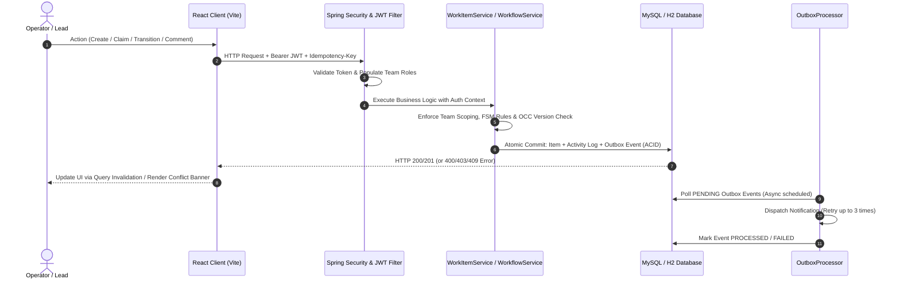

# Newtonite Operations Under Pressure — Work Management Platform

Operational work management platform for multi-team internal environments to triage, track, approve, and resolve incidents, engineering problems, payment investigations, and compliance requests.

Design decisions, alternatives, and trade-offs are documented in [ENGINEERING_DECISIONS.md](ENGINEERING_DECISIONS.md) (covers OCC versioning, atomic claims, idempotency, transactional outbox, and role scoping). Requirements matrix is in [REQUIREMENTS_AUDIT.md](REQUIREMENTS_AUDIT.md).

---

## 1. System Architecture & Request Flow



---

## 2. Setup & Execution Instructions

### Step 1: Database
- **Option A (Default H2 File)**: Embedded H2 database in MySQL compatibility mode. No external database setup required.
- **Option B (Docker MySQL 8)**: Run `docker compose up -d` (MySQL on port 3306; user: `root`, password: `root`).

### Step 2: Backend Configuration & Startup
Configuration keys in `.env.example` / `application.yml`:
| Variable | Default | Purpose & Failure Behavior |
|---|---|---|
| `SERVER_PORT` | `8080` | Backend HTTP listening port. |
| `SPRING_PROFILES_ACTIVE` | `default` | Set to `mysql` when running Docker Compose. |
| `DB_URL` / `DB_USER` / `DB_PASSWORD` | H2 file / `sa` / `""` | Database connection credentials. |
| `JWT_SECRET` | 64-char hex string | HMAC-SHA signing secret. In `prod` profile, default secret throws `IllegalStateException`. |
| `JWT_EXPIRATION_HOURS` | `24` | Token lifespan. Expired tokens return HTTP 401. |
| `VITE_API_BASE_URL` | `http://localhost:8080/api` | Target API URL for frontend client/proxy. |

```bash
cd backend && mvn spring-boot:run
# Or with MySQL: mvn spring-boot:run -Dspring-boot.run.profiles=mysql
```
Backend runs at `http://localhost:8080`.

### Step 3: Frontend Startup
```bash
cd frontend && npm install && npm run dev
```
UI runs at `http://localhost:5173` (Vite dev server proxies `/api` to port 8080).

### Step 4: Run Automated Tests
```bash
cd backend && mvn test       # 19/19 integration tests pass (verified in this run)
cd frontend && npm test      # 14/14 Vitest component tests pass (verified in this run)
```

---

## 3. Seed Demo Accounts & Roles

All demo accounts use password: `password123`

| Username | Full Name | Team & Role | Typical Access |
|---|---|---|---|
| `admin` | System Administrator | Global Administrator | Full cross-team visibility, lead approvals, closed item reopening |
| `sarah.lead` | Sarah Connor | Core Platform (`LEAD`) | Incident triage, lead approvals, item reassignment in Team 1 |
| `alex.member` | Alex Murphy | Core Platform (`MEMBER`) | Create, claim, and transition items, submit for approval in Team 1 |
| `elena.viewer` | Elena Rostova | Core Platform (`VIEWER`), Compliance (`MEMBER`) | Read-only in Team 1, contributor in Team 3 |
| `david.finlead` | David Miller | Payment & Risk (`LEAD`) | Lead approvals and reassignment in Team 2 |
| `maya.finmember` | Maya Patel | Payment & Risk (`MEMBER`) | Payment investigations contributor in Team 2 |

---

## 4. Engineering Assumptions and Non-Goals

- **Role Scoping**: Roles (`VIEWER` < `MEMBER` < `LEAD`) are scoped per team. Global `ADMIN` has cross-team read, audit, and reopen rights.
- **JWT & Session Revocation**: JWTs expire after 24 hours. Token logout is stateless client-side discard; no server-side token blacklist/revocation table exists.
- **Synchronous vs Asynchronous**: Work item state changes, activity audit entries, and outbox event recording execute synchronously in a single ACID transaction. Notification dispatch is processed asynchronously by an in-process scheduled `OutboxProcessor`.
- **Frontend Dashboard Updates**: UI updates via TanStack Query invalidation on mutation and interval polling (`refetchInterval: 30000`); WebSocket/SSE streaming is not implemented.
- **Explicit Non-Goals**: No public user self-registration, no external message broker (Kafka/RabbitMQ), and no distributed cache (Redis).

---

## 5. Failure Handling Matrix

| Scenario | System Behaviour | Evidence (File / Test) | Status |
|---|---|---|---|
| **Duplicate create (same key & payload)** | Replays cached response without duplicate row or audit log | `testIdempotentWorkItemCreation` | Verified |
| **Idempotency key reuse (mutated payload)** | Rejects with HTTP 409 Conflict | `testIdempotencyKeyReuseWithDifferentPayload` | Verified |
| **Concurrent duplicate keys (same user)** | Database unique constraint caught by `saveAndFlush`; yields 409 | `GlobalExceptionHandler.java` | Verified |
| **Lost response & client retry on create** | User-scoped key lookup returns original response body | `testIdempotentWorkItemCreation` | Verified |
| **Lost response & client retry on claim** | Same-user retry returns current item with 200 OK without duplicate event | `testSameUserClaimRetryIsIdempotent` | Verified |
| **Lost response & client retry on transition** | Retrying same status rejected with 400; version mismatch yields 409 | `testDuplicateTransitionRejected` | Verified |
| **Concurrent claim race (2 operators)** | Single atomic SQL update allows 1 winner; losing request receives 409 Conflict | `testConcurrentClaims` | Verified |
| **Stale update (PATCH with old version)** | Optimistic Concurrency Control rejects with 409 Conflict | `testStaleUpdateConflict` | Verified |
| **Disallowed / skip workflow transition** | State machine blocks invalid transition with 400 Bad Request | `testInvalidTransitionRejected` | Verified |
| **Authorization denial (non-Lead approval)** | Non-lead approval attempt rejected with 403 Forbidden | `testNonLeadCannotApprove` | Verified |
| **Authorization denial (cross-team access)** | Cross-team access attempt rejected with 403 Forbidden | `testCrossTeamAccessRejected` | Verified |
| **Prohibited self-approval (segregation)** | Creator/assignee approval blocked with 403 Forbidden | `testCreatorCannotSelfApprove` | Verified |
| **Database transaction failure** | Rollback restores previous item state; activity event row is not written | `testTransactionalRollbackOnFailure` | Verified |
| **Async notification transport retry** | `OutboxProcessor` logs failure, retries up to 3 times, marks FAILED | `testTransactionalOutboxNotificationFlow` | Verified |

---

## 6. HTTP Error Semantics

Standard error body: `{"code": "STRING", "message": "STRING", "status": NUMBER, "timestamp": "ISO-8601"}`

| Status | Condition in this API | Example Message / Behavior |
|---|---|---|
| **400 Bad Request** | Bean Validation failure, unreadable JSON, illegal state transition | `"Invalid transition from OPEN to CLOSED"` |
| **401 Unauthorized** | Missing, expired, or invalid JWT; bad credentials on login | `"Invalid username or password"` |
| **403 Forbidden** | Insufficient role, cross-team access attempt, or self-approval violation | `"Access denied: You are not an active member of team"` |
| **404 Not Found** | Work item or team ID does not exist in database | `"Work item not found: 999"` |
| **409 Conflict** | Stale OCC version, concurrent claim lost, or duplicate idempotency key | `"Stale update conflict: The item has been modified"` |

*Note: Cross-team access requests return `403 Forbidden` (not 404), explicitly indicating authentication succeeded but team-scoped authorization failed.*

---

## 7. Reviewer Demo Walkthrough

1. **Login**: Call `POST /api/auth/login` with `{"username": "alex.member", "password": "password123"}` &rarr; Returns `200 OK` with JWT token.
2. **Create Item**: Call `POST /api/items` with header `Idempotency-Key: demo-key-101` and payload `{"title": "Demo Incident", "type": "PRODUCTION_INCIDENT", "priority": "HIGH", "teamId": 1}` &rarr; Returns `201 Created` (version `0`).
3. **Move Through Workflow**: Call `POST /api/items/{id}/transition` with `{"targetStatus": "IN_PROGRESS"}` &rarr; Returns `200 OK`. Then call again with `{"targetStatus": "AWAITING_APPROVAL"}` &rarr; Returns `200 OK`.
4. **Verify Self-Approval Restriction**: Call `POST /api/items/{id}/transition` to `RESOLVED` using `alex.member` token &rarr; Returns `403 Forbidden` (`Segregation of duties violation: Cannot approve your own work item`). Re-authenticate as `admin` and repeat &rarr; Returns `200 OK`.
5. **Verify Concurrent Claim Race**: Issue two concurrent curl claim requests (`POST /api/items/{id}/claim`) using `alex.member` and `sarah.lead` tokens. Exactly one returns `200 OK`; the other returns `409 Conflict`. Repeating the claim with the winning user returns `200 OK` idempotently without duplicate activity events.

---

## 8. Test Coverage Summary

- **Backend (`NewtoniteOpsIntegrationTests.java`)**: 19 integration tests covering authentication flows, workflow FSM, Lead-only approval, cross-team security, stale updates (OCC), idempotency replay/mutation/scoping, concurrent claim races, and transactional outbox. Verified passing: `19/19` via `mvn test`.
- **Frontend (`components.test.tsx`)**: 14 Vitest component tests covering status/priority badges, role-based action buttons, OCC 409 conflict banners, 403 error boundaries, and search filters. Verified passing: `14/14` via `npm test`.
- **What is NOT covered**: Browser-level end-to-end automation (Playwright/Cypress), multi-node network split-brain simulations, and load/stress benchmarks.

---

## 9. Known Limitations & Production Enhancements

### Current Limitations (Verified in Implementation)
1. **In-Process Asynchronous Worker**: `OutboxProcessor` polls `outbox_events` on a fixed `@Scheduled` delay within the Spring Boot monolith; no external distributed worker cluster or partition consumer exists.
2. **Idempotency Scope**: Header-based persistent idempotency (`idempotency_keys` table) is implemented on `POST /api/items`. Updates and claims rely on OCC versioning and atomic conditional SQL rather than dedicated idempotency headers.
3. **Stateless JWT Revocation**: Logout is client-side token discard. Issued JWTs remain cryptographically valid until 24-hour expiration unless an external token blacklist is added.
4. **Search Strategy**: Search queries use SQL `LIKE %query%` on title and description; full-text indexing (e.g. Elasticsearch/Hibernate Search) is not implemented.
5. **Pagination**: Bounded offset pagination (`Pageable`, default max 100); keyset cursor pagination is not implemented.
6. **Directory Management**: Teams and memberships are read-only directory endpoints; team provisioning is managed via Flyway migrations.
7. **Frontend Test Scope**: Unit and component testing with Vitest/jsdom; no automated browser E2E test suite.

### Future Enhancements
- **With One More Week**:
  - WebSocket/SSE streaming push to eliminate polling for live item status updates.
  - Redis token blacklist for instant server-side revocation on logout.
  - Draft auto-save and client-side offline action queuing.
- **At 10x Scale**:
  - Database read-replica routing for dashboard aggregate queries.
  - Table partitioning by date on `activity_events` and `outbox_events`.
  - Independent background worker service for outbox notification delivery.

---

## 10. REST API Overview

| Method | Endpoint | Description | Auth Scope |
|---|---|---|---|
| `POST` | `/api/auth/login` | Authenticate user and receive JWT | Public |
| `GET` | `/api/auth/me` | Fetch authenticated user profile & team roles | Authenticated |
| `POST` | `/api/auth/logout` | Discard session (stateless JWT client-side) | Authenticated |
| `GET` | `/api/teams` | List authorized teams for user | Authenticated |
| `GET` | `/api/teams/{id}/members` | List members and roles for team | Team VIEWER |
| `POST` | `/api/items` | Create work item (accepts `Idempotency-Key`) | Team MEMBER |
| `GET` | `/api/items` | Paginated search, filter, and sort | Scoped to user teams |
| `GET` | `/api/items/{id}` | Get work item details by ID | Team VIEWER |
| `PATCH` | `/api/items/{id}` | Update item fields (enforces OCC `version`) | Team MEMBER |
| `POST` | `/api/items/{id}/claim` | Atomic claim of unassigned item | Team MEMBER |
| `POST` | `/api/items/{id}/transition` | State transition with approval & OCC rules | Team MEMBER / LEAD |
| `GET` | `/api/items/{id}/activity` | Paginated activity audit ledger | Team VIEWER |
| `GET` | `/api/items/{id}/comments` | Get comment discussion thread | Team VIEWER |
| `POST` | `/api/items/{id}/comments` | Add comment to item | Team MEMBER |
| `GET` | `/api/items/summary` | Dashboard KPI summary counts | Scoped to user teams |
